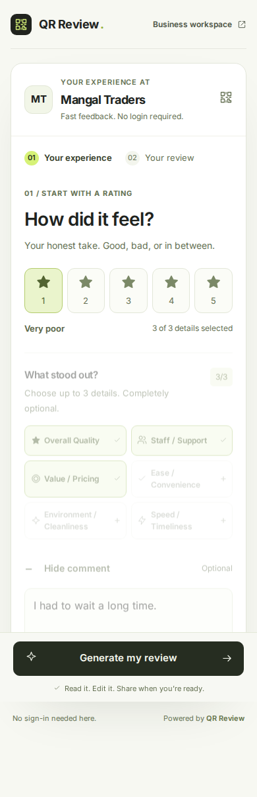

# Studio interface

QR Review uses a warm white canvas, charcoal surfaces, lime accents and locally bundled Inter typography. The new desktop layout frames the customer card with a concise three-part guide, while mobile starts with one task: choosing a rating.

Optional topics and comments appear after the rating is selected. The mobile generation action stays at the bottom of the viewport. Screen transitions move keyboard focus to the new heading. Draft editing, copying and Google handoff are disabled during regeneration; empty drafts cannot be copied or sent to Google. All ratings can reach the Google handoff.

## Customer previews

These captures use the repository's in-memory Mangal Traders demo. They show sample configuration, not production merchant data.




## Workspace

Sign-in, signup, the merchant sidebar, mobile navigation, dashboard, onboarding and billing share the studio theme. Onboarding inputs have explicit accessible labels. Current-page navigation remains visible on desktop and across all six mobile destinations.

## Browser verification

`npm run test:ui` checks customer layouts at 320, 390, 768 and 1440 pixels; mobile action visibility; progressive disclosure; three-topic limits; comments; generation; draft editing/copying/regeneration; keyboard focus; empty draft controls; invalid QR retry; and responsive sign-in/signup pages.

When `REVIEW_REPOSITORY=postgres`, the same suite creates an isolated test owner, completes all five onboarding stages, generates a customer draft through the new QR, visits every workspace page and billing, checks mobile navigation, and signs out/in. CI provides an ephemeral PostgreSQL service and uploads screenshots as the `ui-previews` artifact. It never opens Google or posts a review, connects Places, or collects a payment.

For local checks:

```bash
npx playwright install chromium
npm run test:ui
```

Run all database migrations first when using PostgreSQL. Inter is served from `public/fonts/inter-latin.woff2`; its SIL Open Font License is included alongside it. No external font request is required.

## Typography

Inter is bundled locally. Body copy and actions use 15–16px, supporting labels use 12–14px, and section headings use 20–30px. Display headlines are capped at 54px on the customer page. Heading tracking is limited to −0.025em so letterforms stay distinct. Inputs and review text use 16px to remain readable on phones. Mobile navigation uses compact 11px labels.
