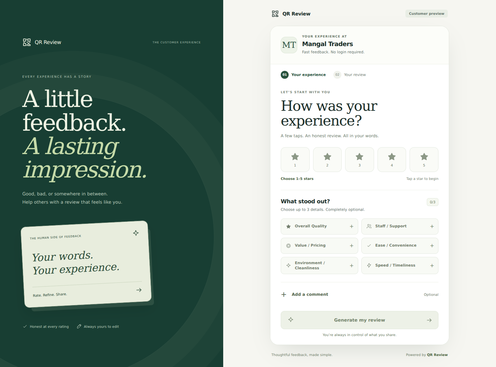
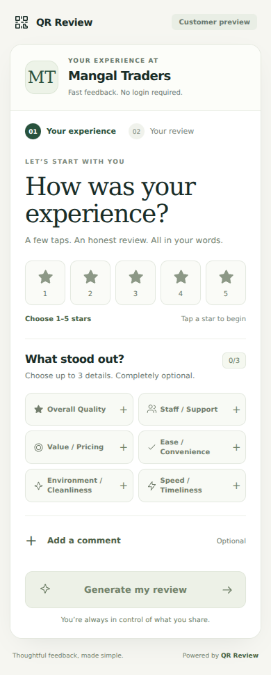

# Premium UI refresh

The interface uses a shared warm ivory and forest palette, editorial serif headings, neutral form surfaces, and consistent SVG icons. The customer flow stays focused on an honest rating, optional topics and comment, an editable draft, and Google handoff.

## Customer previews

These captures use the repository's in-memory Mangal Traders demo. They contain sample configuration, not production merchant data.

## Workspace

Sign-in and signup use the same palette and typography. `workspace-theme.css` applies shared control sizes, readable typography, cards and spacing to dashboard, topic, location, QR, analytics and onboarding screens. Billing styles use the shared tokens. Merchant navigation marks the current page and exposes all six destinations in the mobile bar.

## Validation

Browser checks covered customer layouts at 320, 390, 768 and 1440 pixels, rating selection, the three-topic limit, optional comments, generation, editing, copying, regeneration, returning to details, invalid QR recovery, and responsive sign-in/signup pages. No Google review was posted. Authenticated merchant pages require PostgreSQL; their visual changes were reviewed in source and checked by the production build rather than by a live signed-in browser session.

Typecheck and the existing regression suites are run before merge. Database suites execute in GitHub CI.
